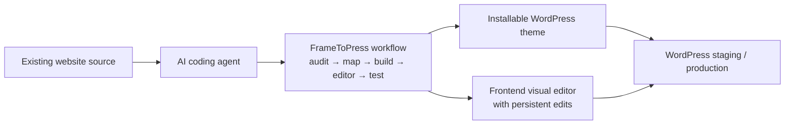

# FrameToPress

**Turn existing websites into editable WordPress themes with AI coding agents.**

[](https://github.com/smakhter10/frame-to-press/actions/workflows/ci.yml)

FrameToPress is an open-source **AI coding-agent skill**. It gives a compatible
coding agent a complete, build-and-verify workflow for converting an existing
website's source code into an installable WordPress theme — preserving the
original layout, animations, and interactions, and adding a frontend
click-to-edit visual editor whose changes persist in WordPress.

FrameToPress is **not** a standalone application, a hosted conversion service,
a WordPress plugin, or a one-click converter. The skill itself does not convert
anything: it instructs and constrains an AI coding agent that has filesystem
and shell access, and it requires that agent to test its output before
claiming success.

## Why it exists

Rebuilding an existing site in WordPress usually means losing design fidelity
or spending days manually recreating pages. FrameToPress structures that work
as a repeatable agent workflow: inventory the source, map every route to a
WordPress template, build a real theme, add persistent visual editing, and
prove — with tests, not assertions — that published edits survive a reload.

It is aimed at developers and agencies who already have a working website
(static, React, Next.js, Vue, Vite, or custom-coded) and want it running as an
editable WordPress theme.

## Features

Capabilities below describe what the skill instructs an agent to do. Items
marked **verified** are exercised by this repository's automated tests; the
rest are workflow requirements the agent must demonstrate in the target
environment (for example, a WordPress staging site).

### Website analysis and migration
- Static, non-executing inventory of a source project (`audit_project.py`):
  frameworks, route candidates, assets, forms, and imports.
- A written conversion map (source route → WordPress template, data source,
  interactions, status) before building.
- Per-component strategy: PHP templates for presentational code, compiled JS
  islands for interactive components, explicit scoping for server-only
  features (auth, SSR, payments) that a theme alone cannot replicate.

### WordPress theme development
- A real, installable classic theme: `style.css` with a valid theme header,
  `functions.php`, `index.php`, route templates, shared parts, and assets
  enqueued with `wp_enqueue_*`.
- Static theme validation (`check_theme.py`) and safe theme ZIP packaging
  (`package_theme.py`) — **verified** by the integration tests in `tests/`.

### Frontend visual editing
- Click-to-edit for text, images, backgrounds, and buttons, restricted to
  authorized users (default capability: `edit_theme_options`).
- Real same-origin iframe device previews — Desktop 1280px, Tablet 820px,
  Mobile 390px — not CSS-scaled approximations.
- Independent desktop/tablet/mobile style overrides, compiled to scoped CSS
  with `@media (max-width: 1024px)` and `@media (max-width: 767px)` defaults.
  The CSS compilation logic is **verified** by the PHP regression tests in
  `tests/` (when PHP is available).

### WordPress content persistence
- Page-scoped edit records keyed by stable element IDs, stored canonically in
  WordPress, with generated CSS rebuilt from those records.
- A non-negotiable serialization rule — empty edit maps serialize as `{}`
  (JSON object), never `[]` — which prevents the historical "published 0
  elements" bug. **Verified** by the PHP regression tests.
- Publish requires an independent readback verification before success is
  reported.

### Security and validation
- Capability checks and nonces on editor save endpoints, allowlisted style
  values and sanitization, and explicit exclusion of checkout, payment,
  personal-data, and other plugin-controlled elements from editing.
- Skill-package structure validation (`validate_skill.py`) — **verified**.

### Packaging and delivery
- Expected deliverables from a conversion: theme ZIP, `CONVERSION-MAP.md`,
  `TEST-REPORT.md`, dependency notes, and installation steps, with untested
  areas stated plainly.

## How it works



1. **Audit** — the agent inventories the source project and writes a
   conversion map.
2. **Build** — routes become WordPress templates; assets, animations, and
   interactions are preserved; dynamic data uses WordPress post types,
   options, or WooCommerce records rather than hardcoded copies.
3. **Editor** — the agent adapts the bundled FrameToPress V3.2 reference
   implementation (`frame-to-press/assets/frametopress-v3.2-reference/`) to
   the new theme's namespace, selectors, and breakpoints.
4. **Persist** — edits are saved as canonical WordPress records and compiled
   to scoped, device-specific CSS.
5. **Verify and package** — static checks, PHP/JS syntax checks, the required
   publish-and-reload regression, and ZIP packaging.

Full detail: [docs/architecture.md](docs/architecture.md).

## Requirements

From the skill's own metadata and scripts — no other versions are claimed:

- An AI coding agent with **filesystem access and shell/code execution**
  (a chat-only model cannot run this workflow).
- The **complete source code and assets** of the website to convert.
- **Python 3.9 or later** to run the bundled tooling scripts
  (`audit_project.py` states Python >= 3.9; the other scripts use the same
  standard library).
- **PHP** and **Node.js** are recommended: PHP for `php -l` checks and the
  builder regression tests, Node for `node --check` on plain JavaScript.
- A **WordPress staging environment** is recommended for final verification.
  Without one, an agent must report runtime behaviour as untested.
- Playwright/Chromium is optional, for browser QA.

## Installation

The skill package is the `frame-to-press/` directory in this repository — the
folder containing `SKILL.md`. Do **not** upload this repository or the skill
ZIP to WordPress → Appearance → Themes; it is not a theme.

Quick options (see [docs/installation.md](docs/installation.md) for the full
guide, verification, updating, and removal):

**Using the bundled installer** (from inside the `frame-to-press/` folder):

```bash
# Claude Code, project scope → <project>/.claude/skills/frame-to-press/
python scripts/install_skill.py claude --scope project --project /path/to/workspace

# Codex / Antigravity, project scope → <project>/.agents/skills/frame-to-press/
python scripts/install_skill.py codex --scope project --project /path/to/workspace
python scripts/install_skill.py antigravity --scope project --project /path/to/workspace
```

**Manually**, copy the `frame-to-press/` folder to your agent's skills
directory:

| Agent | Project location | User location |
|---|---|---|
| Claude Code | `<project>/.claude/skills/frame-to-press/` | `~/.claude/skills/frame-to-press/` |
| Codex / ChatGPT (Codex repos) | `<project>/.agents/skills/frame-to-press/` | `~/.agents/skills/frame-to-press/` |
| Google Antigravity | `<workspace>/.agents/skills/frame-to-press/` | `~/.gemini/config/skills/frame-to-press/` |
| Other Agent Skills clients | Follow the client's own skill discovery rules | — |

Some clients (Claude.ai, ChatGPT) also offer a Skills settings UI where the
skill can be imported as a ZIP. Vendor UIs change; the reference links in
[`frame-to-press/references/INSTALL.md`](frame-to-press/references/INSTALL.md)
point to each vendor's current documentation.

## Quick start

With the skill installed and your website source in the workspace, instruct
your agent:

> Use the `frame-to-press` skill. Convert all files in my existing website
> project into an installable WordPress theme. Preserve the exact design,
> animations and functionality, build the integrated click-to-edit responsive
> page editor, thoroughly test persistent Publish/reload, and deliver the ZIP
> plus a test report. Use staging, not production.

More example prompts — including React/Vite, Next.js, WooCommerce, and
QA-focused variants — are in
[`frame-to-press/references/EXAMPLE-PROMPTS.md`](frame-to-press/references/EXAMPLE-PROMPTS.md),
and a step-by-step walkthrough is in [docs/quick-start.md](docs/quick-start.md).

## Expected output

A completed conversion aims to deliver:

- An **installable WordPress theme ZIP**.
- **Frontend visual editing** with persistent, device-specific edits.
- A **conversion map** and a **test report** stating what was verified and
  what could not be tested in the available environment.
- Installation and configuration notes.

Results depend on source-code completeness, the agent's capabilities, and the
environment provided. Hidden APIs, authentication, payments, server
rendering, and missing licensed assets require integration work and proper
access — the skill requires agents to report those as limitations rather than
claim parity.

## Supported projects and limitations

- Named in the skill metadata: **React, Next.js, Vue, Vite, static
  HTML/CSS/JS, and custom-coded websites**. Vue/Svelte and other frameworks
  follow the same presentational-vs-JS-island decision process described in
  [`frame-to-press/references/MIGRATION.md`](frame-to-press/references/MIGRATION.md).
- A theme alone does **not** replicate an unknown backend. Server actions,
  authenticated SSR, and third-party services need explicitly scoped
  WordPress equivalents or retained external services.
- The bundled V3.2 builder code is a **reference implementation to adapt**,
  not drop-in generic code: prefixes, selectors, fonts, and page identifiers
  must be namespaced per project.
- FrameToPress does **not** claim complete Elementor or Wix feature parity.
- One prompt can start a conversion; one-shot success is not guaranteed for
  every application.

See [docs/capabilities.md](docs/capabilities.md) for the full matrix.

## Repository structure

```text
frame-to-press/            This repository
├── frame-to-press/        The skill package (SKILL.md, references/, scripts/, assets/)
├── scripts/               Repository-level test runner (run_all_checks.py)
├── tests/                 Automated tests (Python integration, PHP regression)
├── docs/                  Project documentation
├── README.md
├── CONTRIBUTING.md
├── CHANGELOG.md
└── SECURITY.md
```

## Running the tests

```bash
python scripts/run_all_checks.py
```

This validates the skill structure, compiles all Python files, runs
`php -l` and `node --check` where those tools are installed (it reports and
skips them when they are not), runs the PHP visual-builder regression suite,
and runs the Python integration tests. The same checks run in GitHub Actions
on every push and pull request (`.github/workflows/ci.yml`).

## Documentation

- [Installation](docs/installation.md)
- [Quick start](docs/quick-start.md)
- [Architecture](docs/architecture.md)
- [Capabilities and limitations](docs/capabilities.md)
- [Troubleshooting](docs/troubleshooting.md)
- Skill references (inside the package): [migration](frame-to-press/references/MIGRATION.md),
  [visual builder](frame-to-press/references/VISUAL-BUILDER.md),
  [WordPress integration](frame-to-press/references/WP-INTEGRATION.md),
  [QA](frame-to-press/references/QA.md),
  [install reference](frame-to-press/references/INSTALL.md)

## Contributing

Contributions are welcome — see [CONTRIBUTING.md](CONTRIBUTING.md). Please
report security issues as described in [SECURITY.md](SECURITY.md), not in
public issues.

## License

**No license file has been added to this repository yet.** Until the
repository owner chooses and adds one, the code is under default copyright
and no reuse rights are granted by this README. An MIT license has been
proposed to the owner; it will only apply if and when a `LICENSE` file is
committed. See the note in [CHANGELOG.md](CHANGELOG.md).

## Acknowledgements

FrameToPress builds on the earlier WordPress Theme Visual Builder work
preserved in `frame-to-press/assets/original-guides/`, and follows the open
Agent Skills format (`SKILL.md` with YAML frontmatter).
