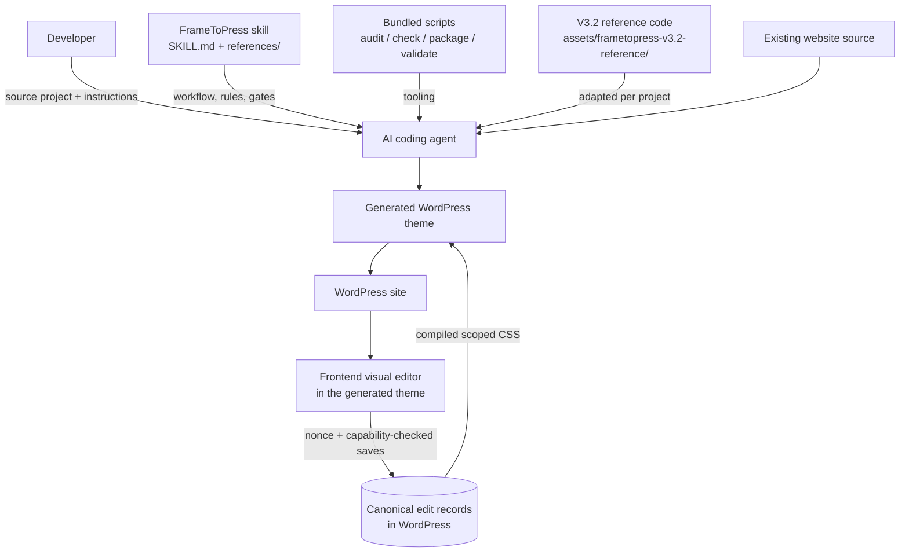

# Architecture

FrameToPress is a **workflow specification for AI coding agents**, not a
hosted conversion engine and not runtime software. Nothing in this repository
runs a conversion by itself: the "engine" is a capable coding agent following
the skill, using the bundled scripts and reference code.

## Components and relationships

### AI agent
Executes the workflow: inspection, planning, code generation, adaptation of
the reference implementation, testing, and packaging. Requires filesystem
and shell access.

### FrameToPress skill (`frame-to-press/`)
- `SKILL.md` — the governing workflow, quality gates, and completion
  contract.
- `references/` — deep guides the agent reads per phase: migration strategy,
  visual-builder specification, WordPress/WooCommerce integration, QA
  matrix, reference-code adaptation, installation, example prompts.
- `scripts/` — deterministic tooling the agent (or a developer) runs:
  source audit, theme checks, theme packaging, skill validation, skill
  installation.
- `assets/` — the working FrameToPress V3.2 builder implementation
  (PHP/JS/CSS) kept as an adaptation reference, plus the preserved
  predecessor guides.

### Existing website source
The input. Static HTML/CSS/JS, React, Next.js, Vue, Vite, or custom code,
with its assets. Server-side behaviour is inventoried and explicitly scoped —
not assumed to be reproducible in a theme.

### Generated WordPress theme
The output: a classic WordPress theme (templates, enqueued assets, theme
header) that preserves the source design and behaviour, with dynamic content
backed by WordPress post types, options, or WooCommerce data where relevant.

### Frontend visual editor (inside the generated theme)
Adapted from the V3.2 reference code. Authorized users edit text, images,
backgrounds, and buttons in a same-origin iframe preview at desktop
(1280px), tablet (820px), and mobile (390px) widths. Dynamic and sensitive
elements (prices, checkout, payment fields, personal data) are excluded.

### WordPress content storage
Edits are stored as **page-scoped canonical records** keyed by stable
element IDs. On Publish, the server validates capability and nonce,
sanitizes allowlisted values, saves the records, compiles scoped
desktop/tablet/mobile CSS from them, and verifies the save with an
independent readback. The canonical records — not the generated CSS file —
are the source of truth, so CSS can be rebuilt after a theme update. See
[`frame-to-press/references/VISUAL-BUILDER.md`](../frame-to-press/references/VISUAL-BUILDER.md)
for the persistence contract, including the `{}`-not-`[]` serialization rule.

## Design principles

- **Fidelity first** — preserve layout, classes, fonts, animations, and
  breakpoints; do not silently redesign.
- **Verify, don't assert** — static checks are labelled static; runtime
  claims require a staging WordPress test.
- **Security by default** — capability checks, nonces, sanitization, and
  allowlisted CSS values on every editor save path.
- **Honest limits** — missing backends, credentials, or licensed assets are
  reported as limitations, never papered over.
